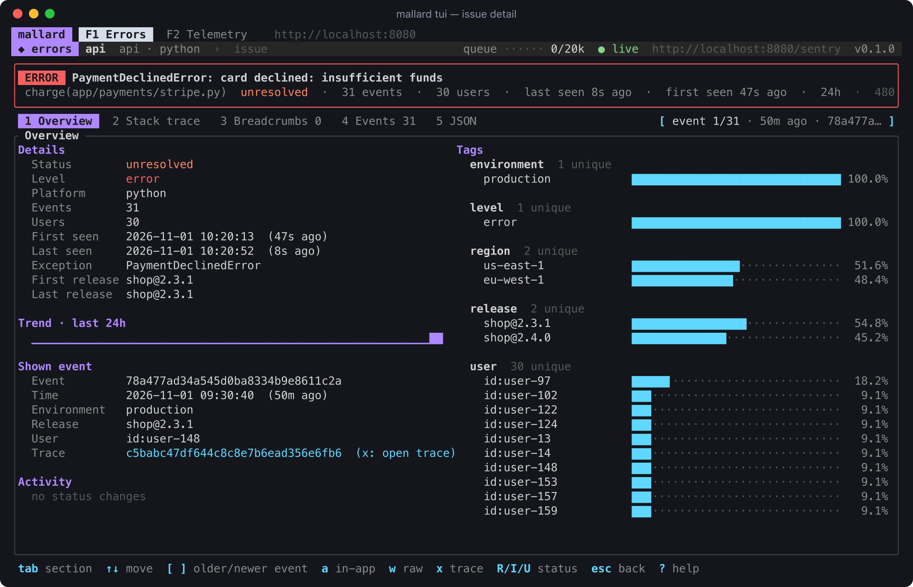
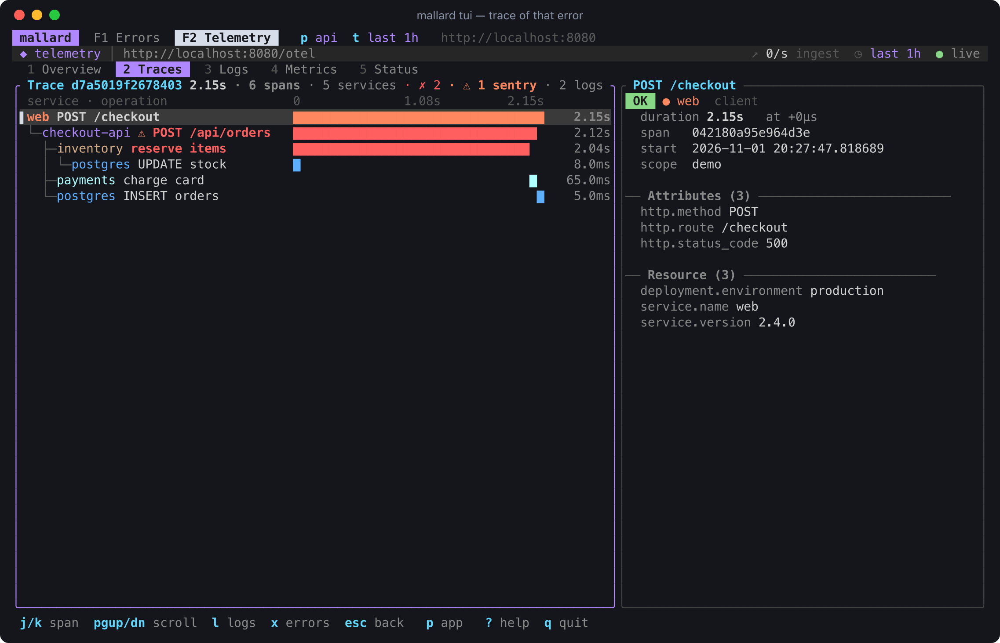
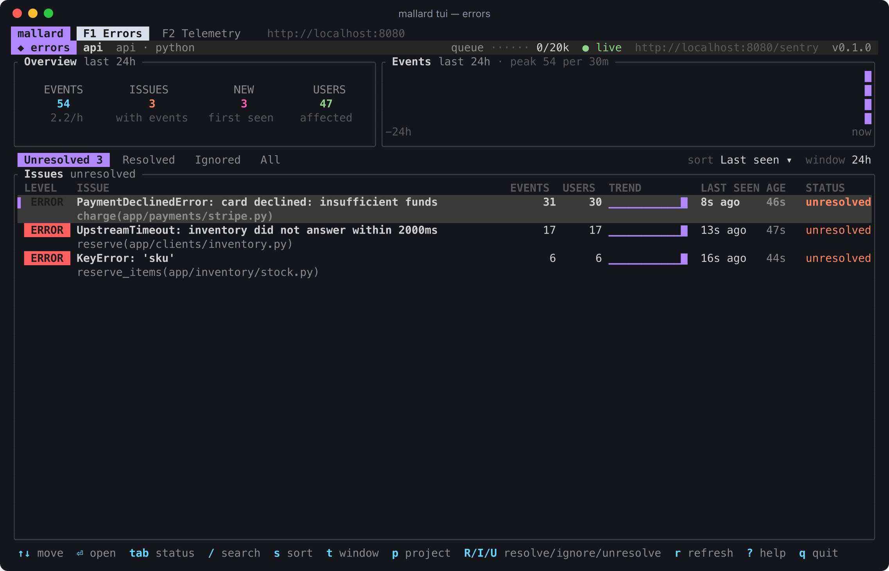
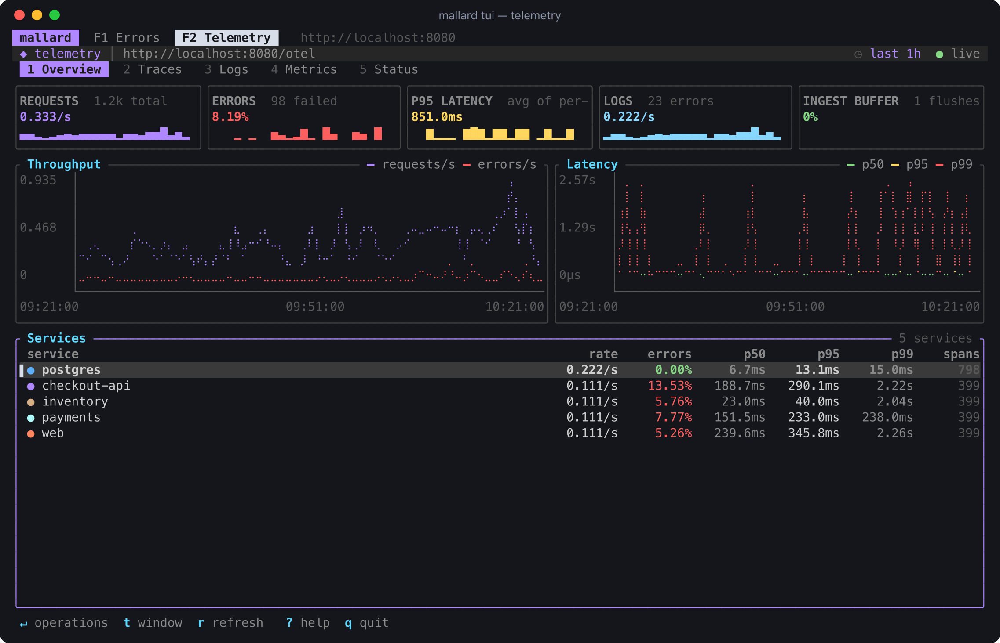
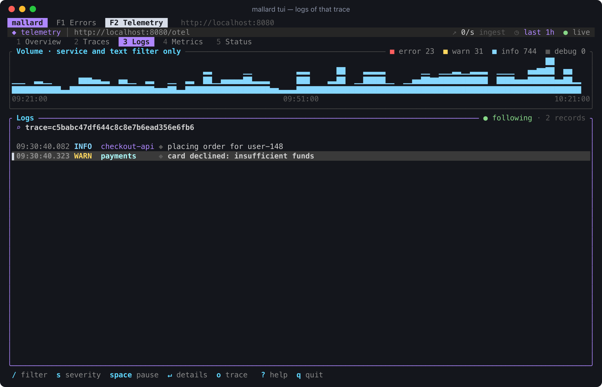

# mallard

Errors, traces, logs and metrics in one place, stored in a
[DuckLake](https://ducklake.select) (DuckDB catalog + Parquet files on disk
or object storage). One binary: server, CLI and terminal UI.

- **Errors**: point any Sentry SDK at mallard by changing only the DSN.
  Issues, grouping, releases, sourcemaps (`sentry-cli` uploads work).
- **Traces, logs, metrics**: send OTLP (HTTP or gRPC) from any
  OpenTelemetry SDK or Collector.
- **Together**: errors and spans share the trace id. `mallard trace <id>`
  shows the span tree with each error and log under the span it happened
  in; in the TUI, `x` jumps from an error to its trace and back.
- **Cheap to run**: one process, Parquet on S3 (or local disk), catalog in
  a DuckDB file or Postgres. No Kafka, ClickHouse or Elasticsearch.

## The terminal UI

`mallard tui`: errors on F1, telemetry on F2, and `x` jumps between them by
trace id.

**An issue, with the trace of the request that failed** — open an issue,
press `x`, and the telemetry tab shows that request's spans with the failing
one in red:

<p>
  
  
</p>

**Errors and telemetry at a glance**:

<p>
  
  
</p>

**Logs of the same request** (`l` on the trace):



Screenshots come from the real TUI and demo data (`scripts/screenshots.sh`).

## Quick start (Docker)

```sh
docker compose -f deploy/compose/docker-compose.yml up -d --build
export MALLARD_URL=http://localhost:8080 MALLARD_TOKEN=dev-token

# Errors: create a project and put the DSN it returns in your Sentry SDK.
mallard errors projects create web        # or: curl -XPOST $MALLARD_URL/sentry/v1/projects ...

# Traces/logs/metrics: point OpenTelemetry at mallard.
export OTEL_EXPORTER_OTLP_ENDPOINT=http://localhost:4318

mallard status
mallard tui
```

The compose stack runs mallard with a Postgres catalog and an S3 bucket
(RustFS). Its credentials are for local use only.

## Quick start (local)

```sh
cargo install --path crates/mallard
MALLARD_API_TOKEN=dev-token mallard serve -c config/mallard.example.toml
```

Data goes to `./data` by default.

## Kubernetes

```sh
helm install mallard deploy/helm/mallard \
  --set publicUrl=https://mallard.example.com --set apiToken=secret \
  --set storage.dataPath=s3://my-bucket/mallard/lake/
```

See `deploy/helm/mallard/values.yaml` and the examples in its `ci/`
folder (DuckDB file on a PVC, MinIO + Postgres, AWS IRSA + Postgres).

## Ports and paths

| where | what |
|---|---|
| `:8080 /sentry/...` | Sentry ingest (DSN `http://KEY@host:8080/sentry/1`), Sentry API `/sentry/v1`, docs `/sentry/docs`, sentry-cli (`--url http://host:8080/sentry`) |
| `:8080 /otel/...` | telemetry query API `/otel/api/v1`, docs `/otel/docs` |
| `:8080 /v1/traces\|logs\|metrics`, `:4318` | OTLP/HTTP |
| `:4317` | OTLP/gRPC |
| `:8080 /healthz /readyz /metrics` | health, Prometheus metrics |

## CLI

```sh
mallard serve -c mallard.toml             # run the server
mallard status                            # health of both sides
mallard trace <trace-id>                  # spans + errors + logs of one trace
mallard errors issues list                # Sentry side: projects, issues, events, sourcemaps
mallard telemetry traces --errors         # OTel side: services, traces, logs, metrics, sql
mallard tui                               # F1 errors, F2 telemetry
mallard errors issues list -s 24h -n 20 --json    # same flags on both sides
```

Client commands read `MALLARD_URL` and `MALLARD_TOKEN`. Both sides share
flags (`--json`, `--color`, `-s/--since`, `-n/--limit`, `-q`, `-t/--trace`),
one output style (times in UTC) and one set of TUI keys (`r` refresh, `t`
time window, `x` same trace on the other tab, `?` help). See
[docs/cli.md](docs/cli.md).

## Configuration

One TOML file, see `config/mallard.example.toml` (every key with its
default). `[server]`, `[storage]` and `[duckdb]` are shared; `[otel]` and
`[sentry]` hold only each side's own settings. Unknown keys are errors. Any
key can be overridden with `MALLARD_<SECTION>__<KEY>`, e.g.
`MALLARD_OTEL__RETENTION__TRACES=0` or `MALLARD_SERVER__API_TOKENS=a,b`
(text settings keep the value as is; lists may be comma separated).
`${NAME}` inside a text value is replaced by environment variable `NAME`.
`mallard check -c mallard.toml --connect` validates a file and opens the
catalog.

## More

- `docs/architecture.md` and `docs/adr/` — how it fits together.
- `docs/sentry/`, `docs/otel/` — each side in depth (data model, capacity,
  compatibility, API).
- `AGENTS.md` — map for contributors and coding agents.

## License

Licensed under either of [Apache License, Version 2.0](LICENSE-APACHE) or
[MIT license](LICENSE-MIT) at your option. Unless you explicitly state
otherwise, any contribution intentionally submitted for inclusion in this
project by you, as defined in the Apache-2.0 license, shall be dual licensed
as above, without any additional terms or conditions.
