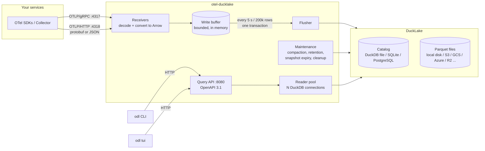

# Architecture

otel-ducklake is one process that receives OpenTelemetry data, stores it in
DuckLake, and answers questions about it over an HTTP API. A CLI and a TUI use
that API.

## Crates

| crate | kind | role |
|---|---|---|
| `odl-api` | lib | Request/response types shared by server and clients. They are the source of the OpenAPI schema. |
| `odl-server` | lib + bin `otel-ducklake` | Receivers, storage, maintenance, query API. Embeddable (see [embedding.md](embedding.md)). |
| `odl-client` | lib | Async typed HTTP client for the query API, including `LogTail` (live tail). |
| `odl-cli` | lib + bin `odl` | CLI commands and the TUI (`odl tui`); both embeddable. |
| `odl-loadgen` | bin `odl-loadgen` | Realistic OTLP traffic for benchmarks and demos. |

The client side (`odl`) does not link DuckDB. It is a small static binary
that talks HTTP only.

## Inside the server

### Receivers (`otlp/`)

- **gRPC** (`tonic`): the standard `TraceService`, `LogsService` and
  `MetricsService`, with gzip/zstd request compression and a configurable
  max message size.
- **HTTP** (`axum`): `POST /v1/traces`, `/v1/logs`, `/v1/metrics` with
  `application/x-protobuf` or `application/json` (OTLP/JSON encoding), and
  `Content-Encoding: gzip | deflate | zstd`. Decompressed size is capped.
  OTLP/JSON doubles may be strings (`"NaN"`, `"Infinity"`, `"-Infinity"`,
  `"1.5"`), as protojson allows. opentelemetry-proto takes them in only a
  few fields, so a body that contains `NaN"`/`Infinity"`, or that it
  refuses, is decoded again by a lenient decoder (`otlp/json.rs`) that
  accepts them in every double field.
- Both convert the request to Arrow record batches (`otlp/convert.rs`) on a
  blocking thread, then push them into the write buffer. Invalid spans are
  reported as OTLP *partial success*.
- Optional bearer-token auth (`auth.ingest_tokens`).

### Write buffer and flusher (`store/writer.rs`)

- A mutex-protected list of record batches per table, with row and byte
  counters. When it holds more than `ingest.max_buffer_bytes`, new requests
  get **HTTP 429 / gRPC `UNAVAILABLE`**. OTLP exporters retry those
  with back-off, so a slow or unavailable object store slows senders down
  instead of losing data or running out of memory.
- One flusher thread wakes every `flush_interval` or when `flush_rows` is
  reached. It appends all batches with DuckDB's Arrow appender in one
  transaction: one DuckLake snapshot per flush.
- On failure the batches go back to the front of the buffer and the flush is
  retried with exponential back-off (max 30 s). After 3 failures in a row
  each batch is written on its own: a batch that fails while others succeed
  (not a conflict) can never be written, so it is dropped, logged at `error`
  and counted in `dropped_rows`; when every batch fails nothing is dropped.
  On shutdown the buffer is drained (3 attempts).
- Durability: data is acknowledged when it is in memory. See
  [ADR 0003](adr/0003-ingest-durability.md) for why there is no queue or WAL,
  and how to get at-least-once delivery anyway.

### Storage (`store/`)

- One in-process DuckDB instance with the DuckLake catalog attached as
  `lake`. All connections are clones of one root connection.
- At start-up: load extensions (`ducklake`, plus `postgres`/`sqlite`/
  `httpfs`/`azure`/`aws` as needed), create secrets, attach, set DuckLake
  options (zstd, row group size, target file size, inlining limit), create
  or migrate tables.
- Data model: [data-model.md](data-model.md).

### Maintenance (`store/maintenance.rs`)

One thread runs these tasks:

| task | default interval | what |
|---|---|---|
| compaction | 10 min | flush inlined rows; merge files < 16 MB |
| full compaction | 6 h | merge files up to `target_file_size` (128 MB) |
| retention | 1 h | delete expired days; expire snapshots older than 1 h; delete unreferenced files after 15 min |

Merges and deletes only touch this schema's tables. Snapshot expiry and file
cleanup are catalog-wide; in mallard the otel side owns them (ADR 0001).

### Query API (`api/`, `query/`)

- `axum` routes generated together with an OpenAPI document (`utoipa`).
  `/openapi.json` serves the document and `/docs` an API reference page. All
  paths are relative, so the router can be nested under a prefix.
- A fixed pool of `query.max_concurrent` DuckDB connections. Each query runs
  on a blocking thread with `query.timeout`; on timeout the query is
  interrupted (`duckdb_interrupt`) and the connection reused.
- All user input reaches SQL as bound parameters. The optional `/api/v1/sql`
  endpoint (off by default) validates queries with DuckDB's own parser; see
  [ADR 0005](adr/0005-sql-endpoint.md).
- Metric math (counter rates with reset detection, histogram percentiles)
  runs partly in SQL and partly in Rust; semantics are in [api.md](api.md).

## Concurrency and scaling

- **One process** handles ingest and queries. DuckDB parallelizes each query
  over all cores (`duckdb.threads`).
- **Several processes** need a catalog that supports several writers:
  PostgreSQL. With a DuckDB-file or SQLite catalog, run exactly one replica.
  With PostgreSQL + object storage, replicas share the lake: each one ingests
  its own traffic and commits its own snapshots, and DuckLake resolves
  concurrent commits. Queries on any replica see all committed data.
- Capacity numbers: [capacity.md](capacity.md).

## Failure behaviour

| failure | effect |
|---|---|
| object store / catalog unavailable | flushes fail and are retried; buffer fills; receivers return 429/`UNAVAILABLE`; exporters retry. Queries fail with 500. |
| process killed (SIGKILL, OOM) | up to `flush_interval` of acknowledged data in memory is lost. |
| SIGTERM / Ctrl-C | receivers stop accepting, buffer is flushed, maintenance stops, exit. |
| query too slow | interrupted after `query.timeout` → 504. |
| too many queries | waits for a free connection up to `query.timeout` → 503. |
| maintenance conflict with another writer | the task fails and is logged; the next run retries. |
