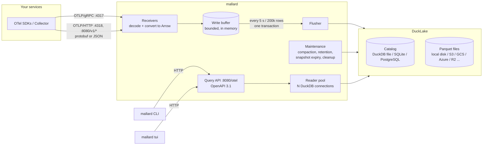

# Architecture

The telemetry side of mallard receives OpenTelemetry data, stores it in DuckLake
(schema `otel`), and answers questions about it over an HTTP API. The `mallard` CLI
and TUI use that API. It runs in one process with the Sentry side; the
[main architecture page](../architecture.md) shows how they fit.

## Crates

| crate | kind | role |
|---|---|---|
| `mallard-otel-api` | lib | Request/response types shared by server and clients. They are the source of the OpenAPI schema. |
| `mallard-otel-server` | lib | Receivers, storage, maintenance, query API. Embeddable (see [embedding.md](embedding.md)). |
| `mallard-otel-client` | lib | Async typed HTTP client for the query API, including `LogTail` (live tail). |
| `mallard-otel-cli` | lib | CLI commands and the TUI; both embeddable. |
| `mallard-otel-loadgen` | bin | Realistic OTLP traffic for benchmarks and demos. |

`mallard-server` runs the server library. A `mallard` build with
`--no-default-features` has the CLI and TUI, talks HTTP only and does not link DuckDB
(ADR 0023).

## Inside the server

### Receivers (`otlp/`)

- **gRPC** (`tonic`): the standard `TraceService`, `LogsService` and
  `MetricsService`, with gzip/zstd request compression and a configurable
  max message size.
- **HTTP** (`axum`): `POST /v1/traces`, `/v1/logs`, `/v1/metrics` with
  `application/x-protobuf` or `application/json` (OTLP/JSON encoding), and
  `Content-Encoding: gzip | deflate | zstd`. Decompressed size is capped.
  OTLP/JSON doubles may be strings (`"NaN"`, `"Infinity"`, `"-Infinity"`,
  `"1.5"`), as protojson allows. opentelemetry-proto takes them in only a
  few fields, so a body that contains `NaN"`/`Infinity"`, or that it
  refuses, is decoded again by a lenient decoder (`otlp/json.rs`) that
  accepts them in every double field.
- Both convert the request to Arrow record batches (`otlp/convert.rs`) on a
  blocking thread, then push them into the write buffer. Invalid spans are
  reported as OTLP *partial success*.
- Optional bearer-token auth (`server.ingest_tokens`).
- The HTTP routes are on `server.otlp_http_addr` and also on `server.http_addr`
  (root `/v1/*`). An ingest hook gives the bridge what it needs from each request.

### Write buffer and flusher (`store/writer.rs`)

- A mutex-protected list of record batches per table, with row and byte
  counters. When it holds more than `otel.ingest.max_buffer_bytes`, new requests
  get **HTTP 429 / gRPC `UNAVAILABLE`**. OTLP exporters retry those
  with back-off, so a slow or unavailable object store slows senders down
  instead of losing data or running out of memory.
- One flusher thread wakes every `flush_interval` or when `flush_rows` is
  reached. It appends all batches with DuckDB's Arrow appender in one
  transaction: one DuckLake snapshot per flush.
- A failed flush is either transient or permanent (`is_permanent` in
  `store/writer.rs`):
  - **Transient** (the default): the batches go back to the front of the
    buffer and the flush is retried with exponential back-off (max 30 s),
    never dropped. This covers every commit error (that is where Parquet
    files and the catalog are written: object store, network, credentials,
    catalog down) and append errors that name a transient cause (`IO Error`,
    `HTTP Error`, connection, out of memory, interrupt, timeout, conflict).
  - **Permanent**: any other error while appending to one table, i.e. the
    batch does not fit that table (a column renamed, dropped or retyped by
    hand, a missing table, a type mismatch, a panic in the conversion).
    That table's batches are then written one by one: those that still fail
    permanently are dropped, logged at `error` with the table and counted
    in `dropped_rows` (`mallard_otel_dropped_rows_total{table}`). The other tables
    are flushed right away, so one broken table does not block the others
    or fill the buffer.
  Appender errors often carry no DuckDB error type ("the column must exist
  in the table"), so the rule lists the transient causes, not the permanent
  ones. An unknown transient cause during an append could drop a batch;
  storage errors happen at commit, which is never permanent.
  On shutdown the buffer is drained (3 attempts).
- Durability: data is acknowledged when it is in memory. See
  [ADR 0003](adr/0003-ingest-durability.md) and
  [ADR 0020](../adr/0020-no-write-ahead-log.md) for why there is no queue or
  WAL, and [deployment.md](deployment.md#with-an-opentelemetry-collector-in-front-recommended-for-zero-loss)
  for at-least-once delivery with a Collector.

### Storage (`store/`)

- One in-process DuckDB instance with the DuckLake catalog attached as `lake`,
  shared with the Sentry side. All connections are clones of one root connection,
  which `mallard_duck::open_connection` opens.
- At start-up: load extensions (`ducklake`, plus `postgres`/`sqlite`/`mysql`/
  `httpfs`/`azure`/`aws` as needed), create secrets, attach, set DuckLake
  options (zstd, row group size, target file size, inlining limit), create
  or migrate this schema's tables.
- Data model: [data-model.md](data-model.md).

### Maintenance (`store/maintenance.rs`)

One thread runs these tasks, on the replica that holds the lease in `otel.meta`
([operations](operations.md#several-replicas)):

| task | default interval | what |
|---|---|---|
| compaction | 10 min | flush inlined rows; merge files < 16 MB |
| full compaction | 6 h | merge files up to `target_file_size` (128 MB) |
| retention | 1 h | delete expired days; expire snapshots older than 1 h; delete unreferenced files after 15 min |

Merges and deletes only touch this schema's tables. Snapshot expiry and file
cleanup are catalog-wide; this side owns them (ADR 0001).

### Query API (`api/`, `query/`)

- `axum` routes generated together with an OpenAPI document (`utoipa`).
  `/otel/openapi.json` serves the document and `/otel/docs` an API reference page.
  Paths in the code are relative; `mallard-server` nests the router under `/otel`.
- A fixed pool of `otel.query.max_concurrent` DuckDB connections. Each query runs
  on a blocking thread with `otel.query.timeout`; on timeout the query is
  interrupted (`duckdb_interrupt`) and the connection reused.
- All user input reaches SQL as bound parameters. The optional `/otel/api/v1/sql`
  endpoint (off by default) validates queries with DuckDB's own parser; see
  [ADR 0005](adr/0005-sql-endpoint.md). The checks live in `mallard_duck::sql`,
  shared with the Sentry side's `/sentry/v1/sql` (ADR 0011).
- Metric math (counter rates with reset detection, histogram percentiles)
  runs partly in SQL and partly in Rust; semantics are in [api.md](api.md).

## Concurrency and scaling

- **One process** handles ingest and queries. DuckDB parallelizes each query
  over all cores (`duckdb.threads`).
- **Several processes** need a catalog that supports several writers:
  PostgreSQL. With a DuckDB-file or SQLite catalog, run exactly one replica.
  With PostgreSQL + object storage, replicas share the lake: each one ingests
  its own traffic and commits its own snapshots, and DuckLake resolves
  concurrent commits. Queries on any replica see all committed data.
- Capacity numbers: [capacity.md](capacity.md).

## Failure behaviour

| failure | effect |
|---|---|
| object store / catalog unavailable | flushes fail and are retried; buffer fills; receivers return 429/`UNAVAILABLE`; exporters retry. Queries fail with 500. |
| one table no longer accepts our rows (schema edited by hand) | that table's batches are dropped (`dropped_rows`, `error` log); other tables keep flushing. |
| catalog invalidated (a DuckDB-file catalog whose checkpoint failed, e.g. out of memory) | nothing is dropped as refused by a table. Pushes get 429/`UNAVAILABLE`, the process stops and exits 1, and its restart attaches the catalog. What was buffered and not yet flushed is lost. |
| process killed (SIGKILL, OOM) | up to `flush_interval` of acknowledged data in memory is lost. To avoid that: a [Collector with a persistent queue](deployment.md#with-an-opentelemetry-collector-in-front-recommended-for-zero-loss) in front. |
| SIGTERM / Ctrl-C | receivers stop accepting, the bridge stores what it holds, maintenance stops, buffer is flushed, exit. |
| query too slow | interrupted after `otel.query.timeout` → 504. |
| too many queries | waits for a free connection up to `otel.query.timeout` → 503. |
| maintenance conflict with another writer | the task fails and is logged; the next run retries. |
